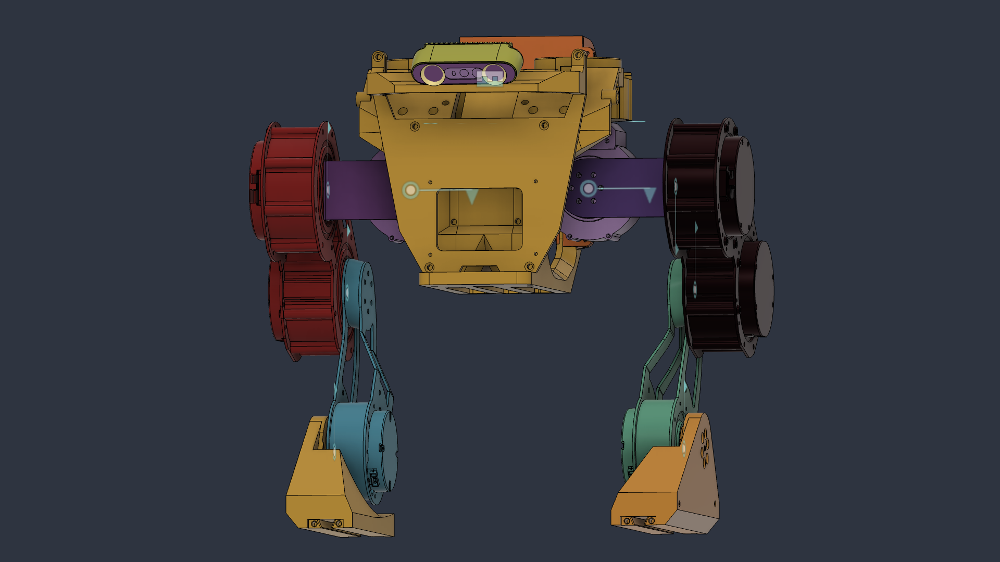

# rivetrobot — Robot Description



## Overview

| Property | Value |
|----------|-------|
| Total mass | 19.458 kg |
| Links | 12 |
| Joints | 11 (10 movable) |
| Assemblies | 18 |
| Root link | `base_link` |

## Table of Contents

- [Kinematic Tree](#kinematic-tree)
- [Link Properties](#link-properties)
- [Joint Properties](#joint-properties)
- [Assembly Breakdown](#assembly-breakdown)
- [Quick Start (ROS 2)](#quick-start-ros-2)
- [Files](#files)

## Kinematic Tree

```
base_link
  └─ Right_Hip_Yaw [revolute]
    Yaw_R [BAKE]
      └─ Right_Hip_Roll [revolute]
        arm_right [BAKE]
          └─ Right_Hip_Pitch [revolute]
            thigh_right [BAKE]
              └─ Right_Knee [revolute]
                shin_right [BAKE]
                  └─ Right_Foot [revolute]
                    foot_right [BAKE]
  └─ Left_Hip_Yaw [revolute]
    Yaw_L [BAKE]
      └─ Left_Hip_Roll [revolute]
        arm_left [BAKE]
          └─ Left_Hip_Pitch [revolute]
            thigh_left [BAKE]
              └─ Left_Knee [revolute]
                shin_left [BAKE]
                  └─ Left_Foot [revolute]
                    foot_left [BAKE]
  └─ Rigid_14 [fixed]
    imu
```

## Link Properties

| Link | Mass (kg) | Material | Collision | Bodies |
|------|-----------|----------|-----------|--------|
| `Yaw_L` | 0.6317 | RS06 | box | 2 |
| `Yaw_R` | 0.6317 | RS06 | box | 2 |
| `arm_left` | 0.0996 | Aluminum_6061 | box | 1 |
| `arm_right` | 0.0996 | Aluminum_6061 | box | 1 |
| `base_link` | 12.5240 | Steel | box | 25 |
| `foot_left` | 0.0661 | Foot | box | 1 |
| `foot_right` | 0.0661 | Foot | box | 1 |
| `imu` | 0.2274 | Steel | box | 1 |
| `shin_left` | 0.7084 | RS02 | cylinder | 5 |
| `shin_right` | 0.7084 | RS02 | cylinder | 5 |
| `thigh_left` | 1.8475 | Aluminum_6061 | box | 4 |
| `thigh_right` | 1.8475 | Aluminum_6061 | box | 4 |

## Joint Properties

| Joint | Type | Parent → Child | Axis | Limits |
|-------|------|---------------|------|--------|
| `Left_Foot` | revolute | `shin_left` → `foot_left` | (0,0,1) | [-15.0°, 30.0°] |
| `Left_Hip_Pitch` | revolute | `arm_left` → `thigh_left` | (0,0,1) | [-25.0°, 60.0°] |
| `Left_Hip_Roll` | revolute | `Yaw_L` → `arm_left` | (0,0,1) | [-20.0°, 20.0°] |
| `Left_Hip_Yaw` | revolute | `base_link` → `Yaw_L` | (0,0,1) | [-20.0°, 15.0°] |
| `Left_Knee` | revolute | `thigh_left` → `shin_left` | (0,0,1) | [-30.0°, 35.0°] |
| `Right_Foot` | revolute | `shin_right` → `foot_right` | (0,0,1) | [-15.0°, 30.0°] |
| `Right_Hip_Pitch` | revolute | `arm_right` → `thigh_right` | (0,0,1) | [-60.0°, 25.0°] |
| `Right_Hip_Roll` | revolute | `Yaw_R` → `arm_right` | (0,0,1) | [-20.0°, 20.0°] |
| `Right_Hip_Yaw` | revolute | `base_link` → `Yaw_R` | (0,0,1) | [-15.0°, 20.0°] |
| `Right_Knee` | revolute | `thigh_right` → `shin_right` | (0,0,1) | [-30.0°, 35.0°] |
| `Rigid_14` | fixed | `base_link` → `imu` | (0,0,1) | — |

## Assembly Breakdown

### 00_GEMINI_336_3D_ALL_ASM_ASM_1_ASM

- **Links**: 
- **Total mass**: 0.000 kg

### 111_1_1_ASM_1_ASM_1_ASM

- **Links**: 
- **Total mass**: 0.000 kg

### 1_ASM_2_ASM_1_ASM_1_ASM

- **Links**: 
- **Total mass**: 0.000 kg

### 2_ASM_3_ASM_1_ASM_1_ASM

- **Links**: 
- **Total mass**: 0.000 kg

### 810_805_518_516_8PIN_ASM_1_ASM_ASM

- **Links**: 
- **Total mass**: 0.000 kg

### BRACKET_ASM_1_ASM_3_ASM_1_ASM

- **Links**: 
- **Total mass**: 0.000 kg

### GEMINI_336_MD_ASM_3_ASM_1_ASM_1_ASM

- **Links**: 
- **Total mass**: 0.000 kg

### GEMINI_336_STACK_ASM_3_ASM_1_AS_ASM

- **Links**: 
- **Total mass**: 0.000 kg

### GEMINI_II_HEAD_ASSEMBLY_ASM_1_A_ASM

- **Links**: 
- **Total mass**: 0.000 kg

### I02_ASM_3_ASM_1_ASM

- **Links**: 
- **Total mass**: 0.000 kg

### LOWER_HOU_ASM_1_ASM_2_ASM_1_ASM

- **Links**: 
- **Total mass**: 0.000 kg

### PART2_ASM_1_ASM_1_ASM_1_ASM

- **Links**: 
- **Total mass**: 0.000 kg

### PCBA_ASM_ASM_1_ASM

- **Links**: 
- **Total mass**: 0.000 kg

### SILICONE_PAD_2_ASM_1_ASM_1_ASM

- **Links**: 
- **Total mass**: 0.000 kg

### UPPER_HOUS_ASM_1_ASM_2_ASM_1_ASM

- **Links**: imu
- **Total mass**: 0.227 kg

### base_link

- **Links**: 
- **Total mass**: 0.000 kg

### imu

- **Links**: 
- **Total mass**: 0.000 kg

### rivetrobot

- **Links**: Yaw_L, Yaw_R, base_link, thigh_right, foot_right, shin_right, arm_right, thigh_left, foot_left, shin_left, arm_left
- **Total mass**: 19.231 kg

## Quick Start (ROS 2)

```bash
# 1. Copy package to your ROS 2 workspace
cp -r rivetrobot_description ~/ros2_ws/src/

# 2. Build
cd ~/ros2_ws
colcon build --packages-select rivetrobot_description
source install/setup.bash

# 3. Visualize in RViz2
ros2 launch rivetrobot_description display.launch.py

# 4. Validate URDF structure
check_urdf install/rivetrobot_description/share/rivetrobot_description/urdf/rivetrobot.urdf

# 5. Print kinematic tree
urdf_to_graphviz install/rivetrobot_description/share/rivetrobot_description/urdf/rivetrobot.urdf
```

**Joint control**: The launch file includes `joint_state_publisher_gui` —
use the sliders to move revolute/prismatic joints in RViz2.

**Topic inspection**:
```bash
# See published joint states
ros2 topic echo /joint_states

# See robot description parameter
ros2 param get /robot_state_publisher robot_description
```

## Files

| Path | Description |
|------|-------------|
| `urdf/rivetrobot.urdf.xacro` | Top-level xacro (entry point) |
| `urdf/rivetrobot.urdf` | Flat URDF (for validation) |
| `urdf/assemblies/` | Per-assembly xacro macros |
| `meshes/` | Visual (OBJ) and collision (STL) meshes |
| `launch/display.launch.py` | Launch robot_state_publisher, RViz, and generated controllers |
| `config/joint_state.yaml` | Joint state publisher config |
| `config/ros2_controllers.yaml` | Generated ros2_control controller manager config |
| `robot_data.yaml` | Supplementary data (beyond URDF) |
| `docs/transforms.md` | Transformation matrices (KaTeX) |

## Customizing

Assemblies tagged `!dummy_` are designed to be swapped out. To replace one:

1. Create your replacement as a xacro macro with the same interface
2. Place it in `urdf/assemblies/`
3. Update the `<xacro:include>` in `urdf/rivetrobot.urdf.xacro`
4. Update meshes in `meshes/<your_assembly>/`

The xacro prefix system (`${prefix}`) ensures link names stay unique
when multiple instances of the same assembly are used.

---
*Generated by Fusion URDF/XACRO Exporter v3.1.1*